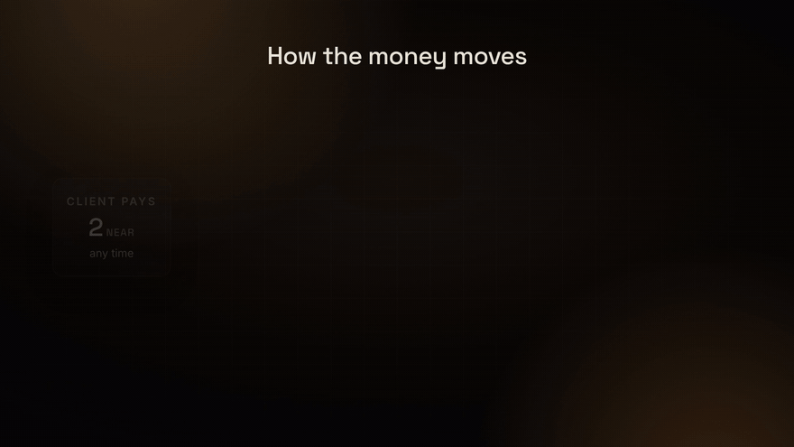
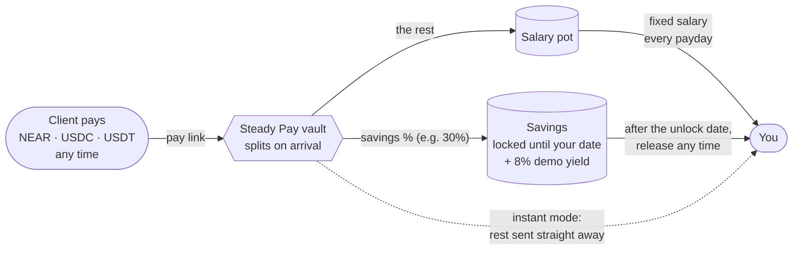
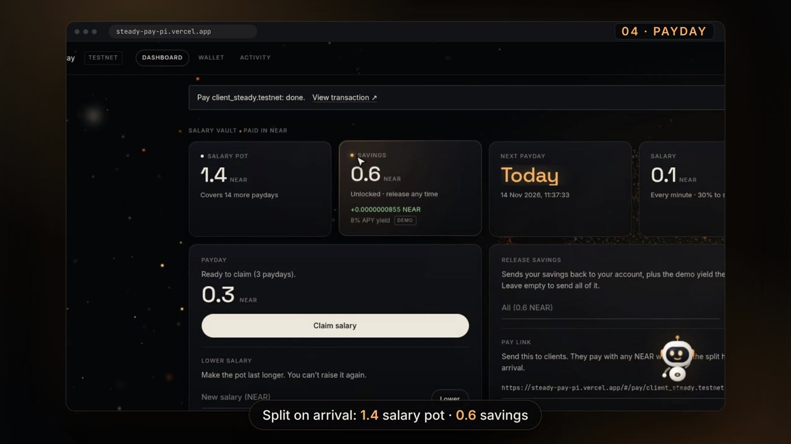

<div align="center">

# Steady Pay

### Get paid in lumps. Live on a salary.

A NEAR vault that turns lumpy freelance income into a fixed salary, with savings set aside on every payment.

[](https://steady-pay-pi.vercel.app)
[](media/steady-pay-demo.mp4)
[](https://testnet.nearblocks.io/address/sp11091716-vault.testnet)


<a href="media/steady-pay-demo.mp4"></a>

<sub>▶ Click the preview for the full 2:24 demo (recorded on the live page, NEAR testnet)</sub>

</div>

---

## The idea

Freelancers get paid unevenly: a big invoice one month, nothing the next. Steady Pay is a NEAR smart contract that holds that lumpy income and pays it back to you as a **fixed salary every period**. Every client payment is split the moment it arrives: your savings percent goes to a locked savings bucket, the rest goes to your salary pot.



> Example: a client pays 1,000 NEAR with 30% tax → 300 NEAR to tax savings, 700 NEAR to the salary pot → with a 100 NEAR salary, you're paid for 7 periods, even if no other client pays.

<table>
<tr>
<td width="50%"></td>
<td>

**Try it in a minute** (testnet, no sign-up)

1. Open **[steady-pay-pi.vercel.app](https://steady-pay-pi.vercel.app)** and connect a NEAR testnet wallet (Meteor works).
2. Set up a vault: a salary, payday **every minute** (demo), a savings %, a lock date.
3. Copy your **pay link** and pay it (any wallet, or your own).
4. Watch the split, wait for payday, **claim**. Release savings after the date.

</td>
</tr>
</table>


## Key rules (enforced on chain)

| Rule | What it means |
|---|---|
| 🔒 **Savings are locked until a date** | Savings can't be moved by anyone before the unlock date chosen at setup (not even the owner), and then only to the savings wallet: by default the owner's own account. Neither the date nor the wallet can be changed later. |
| 📉 **Salary can go down, never up** | `lower_salary` rejects any raise. |
| 🗓️ **No overspending** | You can only take your fixed salary per payday, and only after payday. |
| 🌙 **Quiet months still pay** | Missed paydays add up; one claim pays all of them, as long as the pot has money. |


<details>
<summary><b>Payout modes, other coins, and wording</b></summary>

Each vault also picks a **payout mode** at setup:

- **Instant** (default on the page): savings % locked until the date, the rest is sent straight to the owner's wallet in the same transaction as the payment.
- **Salary**: the rest waits in the salary pot and the owner claims a fixed salary each period (the original Steady Pay idea: quiet months still pay).

**Clients can pay in any coin.** A vault has one main coin (chosen at setup), but its pay link accepts NEAR, USDC or USDT. A payment in another coin is split the same way: the savings % is locked in a separate pocket for that coin until the vault's unlock date, and the rest is sent straight to the owner. If that send fails (owner not registered with the token), it waits in the pocket and can be collected any time (`release_pocket`). No yield on these pockets.

Each vault's main coin is chosen at setup from a dropdown: **NEAR**, **USDC** or **USDT** (any NEP-141 fungible token works; the page offers Ref Finance's testnet `usdc.fakes.testnet` and `usdt.fakes.testnet`).

Each vault's main coin is chosen at setup from a dropdown: **NEAR**, **USDC** or **USDT** (any NEP-141 fungible token works; the page offers Ref Finance's testnet `usdc.fakes.testnet` and `usdt.fakes.testnet`).

On the web page the tax bucket is called **savings**, so the wording fits anyone setting money aside; the contract and CLI keep the `tax` names. Savings stay locked in the vault contract (the one shared Steady Pay vault account that holds every user's money, with separate books per user) until an **unlock date** the owner picks at setup, then go back to the owner.

**Demo yield:** savings in NEAR vaults earn a fixed **8% APY demo yield** while locked, paid out with the savings on release. It is paid from a yield reserve the team tops up (`fund_yield_reserve`), so it is a sponsored bonus for the demo, **not** staking or lending, and it stops if the reserve runs out (unpaid yield stays owed). Token (USDC/USDT) vaults earn no yield yet.

</details>

## Links

| | |
|---|---|
| Live page | https://steady-pay-pi.vercel.app (Vercel, NEAR testnet) |
| Contract (testnet) | [`sp11091716-vault.testnet`](https://testnet.nearblocks.io/address/sp11091716-vault.testnet) |
| Demo video | [`media/steady-pay-demo.mp4`](media/steady-pay-demo.mp4) (2:24, recorded on the live page on testnet) |
| X post | TODO |

Built for the NEAR Hackathon (Real-World Money, Autonomous Business tracks).

## Status

### Real and working
- Smart contract (`contract/`): 67 unit tests passing (`cargo test`); builds to wasm with `cargo near build non-reproducible-wasm`.
- Deployed on NEAR testnet at `sp11091716-vault.testnet`; full flow verified from the CLI (hashes below).
- USDC vaults: deployed to the same account on 13 Nov 2026 and verified from the CLI with testnet USDC `usdc.fakes.testnet` (hashes below). Vaults made before that keep working as NEAR vaults.
- USDT: offered in the setup dropdown; the vault account and demo savings wallet are registered with `usdt.fakes.testnet`. It uses the same contract code path as USDC, but a full USDT run (pay, claim, move savings) has not been verified yet.
- Web page (`web/`): builds with `npm run build`; reads live vault data from testnet. The pay page shows the client only the coin and the payee, not the payee's savings split (it is still public on chain). Signing in with a wallet works (Meteor extension, testnet). The full flow was run by hand from the live page on 14 Nov 2026 and filmed for the demo video (hashes in "Web page run" below): connect wallet, create a NEAR vault with a savings date lock, a client pays 2 NEAR through the pay link, a client pays 1 USDC through the pay link, one claim pays 7 missed paydays (1.4 NEAR), raising the salary is blocked, lowering it works, and savings come back with the demo yield.

### Not done yet
- USDC/USDT *vaults* (paid in a token as the main coin) have not been run by hand from the page; their contract paths are verified from the CLI (hashes below). USDT payments from the page are not hand-tested.
- The pay-page fix that registers the payee with the token in the same transaction (commit `0dcbcc6`, see Known limits) builds but has not been hand-tested yet — TODO
- X post — TODO

## Proof on chain

Every claim in this README links to a real testnet transaction. Click a run to expand it.

<details>
<summary><b>Transaction hashes from a real run on 9 Nov 2026</b></summary>

Transaction hashes from a real run on 9 Nov 2026 (`scripts/walkthrough.sh`, 0.5 NEAR salary every 60 s, 30% tax, client pays 3 NEAR)

| Step | Result | Transaction |
|---|---|---|
| `create_vault` | ok | [4WRCPTb8…](https://testnet.nearblocks.io/txns/4WRCPTb8DbVdAmfsyyDef8CsRMZxWFajNkA31Ema4NST) |
| client `deposit` 3 NEAR | ok → 0.9 tax, 2.1 pot | [Ab6fKEwo…](https://testnet.nearblocks.io/txns/Ab6fKEwoUshQ4zBDQmmDGgzfUu6Hk4ggX2BE9oU8fQ5N) |
| `claim_salary` before payday | fails: "It is not payday yet" | [7QRc9fAP…](https://testnet.nearblocks.io/txns/7QRc9fAPrgaKH8kK3dCQqGoZXqBPfEp26TmKed2zRVPi) |
| `claim_salary` after payday | ok, 0.5 NEAR | [2JjxBXc2…](https://testnet.nearblocks.io/txns/2JjxBXc2m8K9CZzdwSBbXvFxZzBY2ZamyPQgS4LUKDDE) |
| `lower_salary` to 0.9 (a raise) | fails: "Salary can only go down, never up" | [AjinoZGE…](https://testnet.nearblocks.io/txns/AjinoZGEaFyBtqQ65S1B16VzCVJRAtT73zxvy9sDiUam) |
| `lower_salary` to 0.4 | ok | [FZ29GskV…](https://testnet.nearblocks.io/txns/FZ29GskVPKoC9w5XFNLmrJGDVXrp3z376tpQBuAPgXQr) |
| `withdraw_tax` | ok, 0.9 NEAR arrived at the tax wallet | [BcxTF6bu…](https://testnet.nearblocks.io/txns/BcxTF6buqyRoLaBgZswu8HFNTevStMXkQCV4XiqXA9oT) |
| wait ~2 min, `claim_salary` | ok, 3 missed paydays paid at once (1.2 NEAR) | [4NF28H24…](https://testnet.nearblocks.io/txns/4NF28H24b8MSpTc3SuXmio3pZBMjmEaZ6k4sxrwySZTM) |

</details>

<details>
<summary><b>USDC run on 13 Nov 2026</b></summary>

USDC run on 13 Nov 2026 (10 USDC salary every 60 s, 30% tax, token `usdc.fakes.testnet`, owner `sp11091716-client.testnet`)

| Step | Result | Transaction |
|---|---|---|
| `create_vault` with `"token":"usdc.fakes.testnet"` | ok | [wAdW9RGC…](https://testnet.nearblocks.io/txns/wAdW9RGCygQKe5xLQveVxwVcseVsWRDa249HAqC3ybw) |
| client `ft_transfer_call` 100 USDC, `msg` = owner | ok → 30 tax, 70 pot | [8cxFcFz1…](https://testnet.nearblocks.io/txns/8cxFcFz13uq8D3ngQVms6aV5ExCLAEF65JPYXxG1REHT) |
| `ft_transfer_call` 5 USDC to an account with no USDC vault | refunded, payer balance unchanged | [Am5weARb…](https://testnet.nearblocks.io/txns/Am5weARbwsqbTyJwJ4dT2tuxubTCxntTKPYmFVfn21ym) |
| `claim_salary` after payday | ok, 10 USDC to owner | [2W9VVx1M…](https://testnet.nearblocks.io/txns/2W9VVx1MhruZB7SEaJVEDNyDzVACphkASazYEqFroVwA) |
| `withdraw_tax` | ok, 30 USDC arrived at the tax wallet | [CKoxcgfp…](https://testnet.nearblocks.io/txns/CKoxcgfpa7xMCAh5msLgLX8tJ4hFogRDLScjpyAjS6a4) |

</details>

<details>
<summary><b>Savings date lock, run on 14 Nov 2026</b></summary>

Savings date lock, run on 14 Nov 2026 (NEAR vault for `sp11091716-tax.testnet`, no savings wallet given so it defaults to the owner, savings locked for 90 s, client pays 1 NEAR)

| Step | Result | Transaction |
|---|---|---|
| `create_vault` with `savings_unlock_ms` | ok | [2zqtWbPU…](https://testnet.nearblocks.io/txns/2zqtWbPUor48iEggQzwjpichsvwE4CVvme5owRdCeKHr) |
| client `deposit` 1 NEAR | ok → 0.3 savings, 0.7 pot | [4XJqyhXv…](https://testnet.nearblocks.io/txns/4XJqyhXvcTToPPdS1U8TZ3CevrF6vD1SuXfwAWqYtggy) |
| `withdraw_tax` before the date | fails: "Your savings are locked until the unlock date" | [EtZTWMS5…](https://testnet.nearblocks.io/txns/EtZTWMS5K2T2wX1LtRzeo44pomKeP2AGGe1bSh26zzz6) |
| `withdraw_tax` after the date | ok, 0.3 NEAR back to the owner, log "Steady Pay savings released" | [ANMo4siZ…](https://testnet.nearblocks.io/txns/ANMo4siZHXV8kKMhNHjAt1KTLpksiM8v3yHbQKodABt2) |
| `claim_salary` | ok, log "Steady Pay salary · 1 payday" | [CPcQX56e…](https://testnet.nearblocks.io/txns/CPcQX56e4f3wEBCbueFWRxnC8CKjTqJss1ug5wSNbht4) |

</details>

<details>
<summary><b>Instant mode, run on 14 Nov 2026</b></summary>

Instant mode, run on 14 Nov 2026 (new account `inst.sp11091716-client.testnet`, 30% savings locked for a day, client pays 1 NEAR)

| Step | Result | Transaction |
|---|---|---|
| `create_vault` with `"instant":true` | ok | [FSKp9no4…](https://testnet.nearblocks.io/txns/FSKp9no4v2fpxMyMe3oX1yzfoYQSicqTjNo4qYWDRFUL) |
| client `deposit` 1 NEAR | ok → 0.3 locked as savings, 0.7 sent to the owner in the same transaction (owner balance 0.9898 → 1.6898), log "Steady Pay payment" | [HkTfhzK5…](https://testnet.nearblocks.io/txns/HkTfhzK55ty3Wx3jw6HtR37SXgArxXSfe6tVp6peTfth) |

</details>

<details>
<summary><b>Demo yield, run on 14 Nov 2026</b></summary>

Demo yield, run on 14 Nov 2026 (reserve funded with 1 NEAR; new vault `yld.sp11091716-client.testnet`, 0.09 NEAR savings locked for 60 s)

| Step | Result | Transaction |
|---|---|---|
| `fund_yield_reserve` 1 NEAR | ok | [5UC8My4F…](https://testnet.nearblocks.io/txns/5UC8My4Fk8jeqUgR3GqPT259y13iCDNj44DhrNDkxW1j) |
| `withdraw_tax` after the unlock | ok: 0.09 NEAR savings + 0.000000015 NEAR yield in one transfer, log "Steady Pay savings released + demo yield"; reserve down by the same amount | [5YNJyLBF…](https://testnet.nearblocks.io/txns/5YNJyLBFAditV1VVRvMBLbapkzrLpEhnWu96GfREnTZD) |

</details>

<details>
<summary><b>Other coins, run on 14 Nov 2026</b></summary>

Other coins, run on 14 Nov 2026 (NEAR vault `slowos1008.testnet`, 30% savings)

| Step | Result | Transaction |
|---|---|---|
| client pays 10 USDT to the NEAR vault | ok: 7 USDT sent to the owner, 3 USDT locked in the USDT pocket | [5wZ83u7J…](https://testnet.nearblocks.io/txns/5wZ83u7JAA3x74UiZrS7L6uASTH9g7XACqkud35Fpw47) |
| client pays 10 USDC to the NEAR vault | ok: 7 USDC sent to the owner (100 → 107), 3 USDC locked; NEAR books unchanged | [B29zKLjw…](https://testnet.nearblocks.io/txns/B29zKLjwgQoufdUMqFLQu96VafS5DFMAiF82ENG9APPr) |
| client pays 0.1 NEAR to a USDT vault | ok: 0.07 NEAR to the owner, 0.03 locked in its NEAR pocket | [21CHyU5F…](https://testnet.nearblocks.io/txns/21CHyU5Fu8up28BwkYoEZctRTk8BU1qGMThdTR4evsZM) |

</details>

<details>
<summary><b>Web page run, by hand from https://steady-pay-pi.vercel.app on 14 Nov 2026</b></summary>

Web page run, by hand from https://steady-pay-pi.vercel.app on 14 Nov 2026 (filmed for the demo video). Freelancer `client_steady.testnet`: NEAR vault, 0.2 NEAR salary every 60 s, 30% savings locked for 5 minutes. Client `slowos1008.testnet`.

| Step | Result | Transaction |
|---|---|---|
| `create_vault` from the setup page | ok | [8zYh6iXq…](https://testnet.nearblocks.io/txns/8zYh6iXqar94ydPtyn5Je31AxRWo1nX8fJdqy4D8aNG3) |
| client pays 2 NEAR through the pay link | ok → 0.6 savings, 1.4 salary pot (7 paydays) | [6XopCqUB…](https://testnet.nearblocks.io/txns/6XopCqUBCZAmD6v2ZtRZA54TF5TBxc3YNyrpWmcxEhov) |
| client gets 100 test USDC ("Get 100 test USDC" button) | ok | [FM5kCGj1…](https://testnet.nearblocks.io/txns/FM5kCGj1TAh9P5Fywb36tZNNfutj3QgqA3gWDyv4QJiQ) |
| client pays 1 USDC through the pay link | payment ok: 0.3 USDC locked as savings; forwarding the other 0.7 failed because the freelancer was not registered with USDC, so it stayed in the vault's USDC pocket (log `payout_failed`). The wallet showed this as an error; fixed in the page afterwards (see Known limits) | [CdjCfw3k…](https://testnet.nearblocks.io/txns/CdjCfw3kb6R9CNtiBHbKAZTAZs2qY1iM9sPdEsUMNcFE) |
| `claim_salary` after several paydays | ok, 7 paydays paid at once (1.4 NEAR) | [DG1nGDNq…](https://testnet.nearblocks.io/txns/DG1nGDNqHtEoDKRk3LaqfPAnaWc6fP8CwKW1SHMzUemj) |
| `claim_salary` again straight away | fails: "It is not payday yet" | [DCAhEQd8…](https://testnet.nearblocks.io/txns/DCAhEQd8omisMUAmqMpkfcTkCQQUDAbLr1wci5hzbc9) |
| `lower_salary` to 1 (a raise) | fails: "Salary can only go down, never up" | [5f4KJHQE…](https://testnet.nearblocks.io/txns/5f4KJHQEPQqkZcxfxyWbWU2h7zoTitoMsW1kz355yaA1) |
| `lower_salary` to 0.1 | ok | [EY8fNdB2…](https://testnet.nearblocks.io/txns/EY8fNdB2vjo4BoZdB8nazYm5pUG5XQEeZze6uxTBsPNP) |
| `withdraw_tax` ("Release savings") after the unlock | ok: 0.6 NEAR savings + 0.000000745 NEAR demo yield back to the owner | [Bzv34G1U…](https://testnet.nearblocks.io/txns/Bzv34G1UD8a1S916TUDLKTZdHuMiVaPebCsyGTr2o6Qr) |

</details>

<details>
<summary><b>Web page run 2</b>: the sharp 1080p clips in the demo video</summary>

Same vault (`client_steady.testnet`, by then on a 0.1 NEAR salary), 14 Nov 2026. To film the pay link without a second wallet, the owner paid their own pay link (anyone can). Vault creation in the video is from run 1 (one vault per account).

| Step | Result | Transaction |
|---|---|---|
| pays 2 NEAR through the pay link | ok → 0.6 savings, 1.4 salary pot (14 paydays of 0.1) | [93FUv7uF…](https://testnet.nearblocks.io/txns/93FUv7uFbztLu4bCuzfd6JKckhGasHfJKbPbJUQ6UoKz) |
| "Get 100 test USDC" | ok (also registers the account with USDC) | [26CiaEzc…](https://testnet.nearblocks.io/txns/26CiaEzc4Hr1wDsRGNCrGDkTJYLVT6SWooVpekAELaNK) |
| pays 1 USDC through the pay link | ok: 0.3 USDC locked as savings, 0.7 USDC forwarded to the owner | [9SXLv5Pe…](https://testnet.nearblocks.io/txns/9SXLv5PeVFBvDpZwcm9xqdHR3HmAjzmN6EFEbZ4ntQWh) |
| `claim_salary` | ok, 3 paydays paid at once (0.3 NEAR), log "Steady Pay salary · 3 paydays" | [675FtUkD…](https://testnet.nearblocks.io/txns/675FtUkDNg6Z7cQHuQ1U6FNXT7XJdQixE4hFBNgDKDYg) |
| `lower_salary` to 1 (a raise) | fails: "Salary can only go down, never up" | [9oQmNbdV…](https://testnet.nearblocks.io/txns/9oQmNbdV4qQmAXWvmdtZAkbxH6wko7PtwDRteZ1hckQq) |
| `lower_salary` to 0.05 | ok | [BifvjhvU…](https://testnet.nearblocks.io/txns/BifvjhvUMMG1kmF6z7iN2weBDzr6CUCkbZG2oSTGSbRA) |
| `withdraw_tax` ("Release savings") | ok, savings + demo yield back to the owner, log "Steady Pay savings released + demo yield" | [3kmFQkRC…](https://testnet.nearblocks.io/txns/3kmFQkRCQHQ65jjaZfNszSvcuKFnZQBa2GZbgxGoTMPe) |

</details>

On-chain messages: every payout carries a readable message. Token payouts put it in the `ft_transfer` memo; plain NEAR transfers have no memo field, so the contract writes it as a log line on the transaction.

Run it yourself against any deployment: `scripts/walkthrough.sh <contract> <freelancer> <client> <tax_wallet>` (accounts must be in `~/.near-credentials`).

## How it works

See [ARCHITECTURE.md](ARCHITECTURE.md) for the design, method table and demo script.

<details>
<summary><b>Contract methods</b></summary>

| Method | Who | What |
|---|---|---|
| `create_vault(salary, period_ms, tax_percent, tax_wallet?, token?, savings_unlock_ms?, instant?)` | you, once | attach ≥ 0.01 NEAR (exactly 0.01 for instant or token vaults); `tax_wallet` defaults to you; `token` = token contract, omit for NEAR; `savings_unlock_ms` = Unix ms, up to 10 years ahead; `instant: true` = forward the non-savings share on every payment (salary/period then unused) |
| `deposit(owner)` | any client | NEAR vaults: attach the payment |
| `ft_on_transfer` (via the token's `ft_transfer_call`) | any client | token vaults: `msg` = owner account ID |
| `claim_salary()` | you | salary vaults: after payday. Instant vaults: collects anything a failed forward left in the vault, any time |
| `release_pocket(coin?)` | you | other-coin pocket: waiting money any time, locked savings after the unlock date; `coin` = token, omit for NEAR |
| `get_pockets(owner)` | view | the vault's other-coin pockets |
| `withdraw_tax(amount?)` | you | only on/after the unlock date; always goes to your tax wallet |
| `lower_salary(new_salary)` | you | lower only |
| `get_vault(owner)` | view | |

Amounts are strings in the vault coin's smallest unit: yoctoNEAR (1 NEAR = 10^24) or the token's base unit (USDC has 6 decimals, so 1 USDC = 1000000).

</details>

## Run it

<details>
<summary><b>Contract: test, build, deploy</b></summary>

```bash
rustup target add wasm32-unknown-unknown
cd contract
cargo test
cargo near build non-reproducible-wasm   # -> target/near/steady_pay.wasm
```

Deploy to testnet with [near-cli-rs](https://github.com/near/near-cli-rs):

```bash
near contract deploy <ACCOUNT>.testnet use-file target/near/steady_pay.wasm \
  with-init-call new json-args '{}' prepaid-gas '30 Tgas' attached-deposit '0 NEAR' \
  network-config testnet sign-with-keychain send
```

</details>

<details>
<summary><b>CLI walkthrough</b> (create, pay, claim, release from the terminal)</summary>

```bash
C=<CONTRACT>.testnet; ME=<FREELANCER>.testnet; CLIENT=<CLIENT>.testnet; TAX=<TAX_WALLET>.testnet

# 1. Set up: 1 NEAR salary every 60 s, 30% tax
near contract call-function as-transaction $C create_vault \
  json-args "{\"salary\":\"1000000000000000000000000\",\"period_ms\":60000,\"tax_percent\":30,\"tax_wallet\":\"$TAX\"}" \
  prepaid-gas '30 Tgas' attached-deposit '0.01 NEAR' sign-as $ME network-config testnet sign-with-keychain send

# 2. Client pays 10 NEAR -> 3 to tax, 7 to pot
near contract call-function as-transaction $C deposit json-args "{\"owner\":\"$ME\"}" \
  prepaid-gas '30 Tgas' attached-deposit '10 NEAR' sign-as $CLIENT network-config testnet sign-with-keychain send

# 3. Look at the vault
near contract call-function as-read-only $C get_vault json-args "{\"owner\":\"$ME\"}" network-config testnet now

# 4. After 60 s: claim salary
near contract call-function as-transaction $C claim_salary json-args '{}' \
  prepaid-gas '50 Tgas' attached-deposit '0 NEAR' sign-as $ME network-config testnet sign-with-keychain send

# 5. Send tax savings to the tax wallet
near contract call-function as-transaction $C withdraw_tax json-args '{}' \
  prepaid-gas '50 Tgas' attached-deposit '0 NEAR' sign-as $ME network-config testnet sign-with-keychain send
```

Pay a USDC vault from the CLI:

```bash
near contract call-function as-transaction usdc.fakes.testnet ft_transfer_call \
  json-args "{\"receiver_id\":\"$C\",\"amount\":\"100000000\",\"msg\":\"$ME\"}" \
  prepaid-gas '100 Tgas' attached-deposit '1 yoctoNEAR' sign-as $CLIENT network-config testnet sign-with-keychain send
```

The contract account, the owner and the tax wallet must each be registered with the token (`storage_deposit`) to hold it. The web page offers buttons for this. `usdc.fakes.testnet` has a public `mint`, so the page can also hand out test USDC.

Run it yourself against any deployment: `scripts/walkthrough.sh <contract> <freelancer> <client> <tax_wallet>` (accounts must be in `~/.near-credentials`).

</details>

<details>
<summary><b>Web page: run locally</b></summary>

```bash
cd web
cp .env.example .env    # set VITE_CONTRACT_ID (optional: VITE_USDC_ID)
npm install
npm run dev             # or: npm run build -> dist/
```

</details>

## Known limits

- The 8% yield is a demo: a fixed rate paid from a reserve the team funds, not real staking or lending, and only for NEAR vaults. Real yield (NEAR staking, stablecoin lending) is the next step.

- The vault account `sp11091716-vault.testnet` still has a full-access key (the developer's), so the developer could deploy new code with different rules. The locks are enforced by the current code only; removing that key would make the rules permanent (not done, since this is a testnet build still being changed).

- Testnet only. Not audited.
- No AI. The "Steady" character (an animated mascot that floats around the page and opens a chat when clicked) is rule-based: it matches keywords to built-in answers and fills in numbers from your vault; it does not call any AI model. The "suggest a salary" helper is plain arithmetic: the lowest of the monthly incomes you type in, minus your tax percent, computed in your browser.
- There is no way to close a vault or change the tax wallet / period / tax percent after setup.
- 0.01 NEAR of the setup deposit is kept by the contract for storage and is not returned.
- Each vault has one main coin, fixed at setup. Payments in other coins skip the salary pot and demo yield: only the savings share is kept (in a per-coin pocket), the rest is forwarded immediately.
- Paying in a token to someone not registered with that token: the vault keeps the savings share and tries to forward the rest; if the payee isn't registered, the forward fails and the money waits in the vault's pocket for that coin (the Release / Collect button under "Other coins" on the dashboard, once registered). Since commit `0dcbcc6` the pay page registers the payee in the same transaction (the client pays the ~0.00125 NEAR storage fee) so this no longer happens from the page; other wallets or scripts can still hit it.
- Token vaults pay out only to accounts registered with the token. If the owner or tax wallet isn't registered, the transfer fails and the money stays in the vault (rolled back); the page shows a "register" step.
- The contract accepts any NEP-141 token the owner names at setup; it does not check that the token is genuine. The page only offers testnet USDC and USDT (`usdc.fakes.testnet`, `usdt.fakes.testnet`: test tokens with public minting, not Circle's USDC or Tether's USDT).
- Tax percent is applied with integer math and rounds down by up to 1 yoctoNEAR per payment (in the salary pot's favour); no money is lost.
- Paydays are based on block time, so a claim can be a few seconds later than the countdown.
- The Activity page reads your history from the NearBlocks indexer and lists only transactions you signed; payments clients send you are counted in the Wallet page totals instead.
